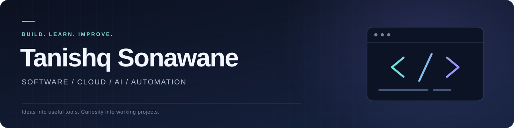

# Building practical software

Exploring cloud, AI, and automation through hands-on projects.

I'm a Computer Science undergraduate at MIT-ADT University, graduating in 2027.
I build web and desktop applications, explore how systems work behind the interface,
and document what I learn. My experience includes an SDE internship and freelance
development for a client in Dubai.

[Explore my projects](https://github.com/tanishqsgit?tab=repositories) ·
[LinkedIn](https://www.linkedin.com/in/tanishqsonawane1823/)

## Selected projects

| Project | What it does | Engineering focus |
| --- | --- | --- |
| [SquadUp — Esports Team Finder](https://github.com/tanishqsgit/ETF-SQUAD-UP) | Helps players discover teammates, form squads, and exchange messages | React, Node.js, PostgreSQL, REST APIs, Socket.io |
| [SAA Study Studio](https://github.com/tanishqsgit/AWS-SAA-EXAM-PREP) | A local-first AWS study app with practice papers, a structured course, and saved progress | TypeScript, React, Electron, browser storage, offline behavior |
| [Finance Tracker](https://github.com/tanishqsgit/finance-tracker) | Tracks expenses, monthly budgets, and spending summaries | Python, FastAPI, SQLAlchemy, authentication, API design |
| [Docs Quality Toolkit](https://github.com/tanishqsgit/docs-quality-toolkit) | Checks Markdown links, titles, metadata, and terminology | Python, automated tests, JSON diagnostics, GitHub Actions |
| [Shubham Water Park](https://github.com/tanishqsgit/Shubham-WaterPark) | A photo-led website with responsive layouts and motion controls | React, TypeScript, animation, accessible interactions |
| [AgentOps — Team Project Documentation](https://github.com/tanishqsgit/7th-SEM-Documentation) | Documents an AI-agent orchestration platform and its architecture | TypeScript, SQLite, queues, scheduling, AI CLI adapters |

SquadUp offers a browser demo and a separate full-stack setup. AgentOps is a team
project; the linked repository contains documentation rather than runnable source.
Each repository explains its current scope and setup requirements.

## What I work on

- **Web and desktop applications:** user interfaces, APIs, authentication, data models,
  local persistence, and packaging applications people can run.
- **Automation and AI integrations:** small Python tools, repeatable checks,
  provider adapters, and workflows that keep human review visible.
- **Cloud and systems:** learning AWS architecture and exploring queues, storage,
  deployment configuration, and recovery considerations through projects.
- **Clear technical communication:** setup instructions, task-based guides,
  troubleshooting, and explanations of system behavior.

## Experience

**Freelance Full-Stack Developer · June–September 2026** 
Built a desktop project and financial tracker for a Dubai client, including
multi-currency records, reporting, Excel import/export, authentication, and offline storage.

**SDE Intern, Catasoft Pvt. Ltd. · June–August 2025** 
Worked on JavaScript and React features, debugging, testing, and remote collaboration
using Git and GitHub.

## Tools I use

**Languages:** JavaScript, TypeScript, Python, SQL 
**Applications:** React, Node.js, Express, FastAPI, Electron 
**Data and workflow:** PostgreSQL, SQLite, SQLAlchemy, Git, GitHub Actions

## Explore the work

- **Full-stack and backend:** start with [SquadUp](https://github.com/tanishqsgit/ETF-SQUAD-UP)
  and [Finance Tracker](https://github.com/tanishqsgit/finance-tracker).
- **Desktop and offline applications:** see [SAA Study Studio](https://github.com/tanishqsgit/AWS-SAA-EXAM-PREP).
- **Frontend and interaction design:** see [Shubham Water Park](https://github.com/tanishqsgit/Shubham-WaterPark).
- **Python automation:** run [Docs Quality Toolkit](https://github.com/tanishqsgit/docs-quality-toolkit).
- **Writing and architecture:** read the [API task guide](https://github.com/tanishqsgit/finance-tracker/blob/main/docs/first-expense.md)
  or [AgentOps documentation](https://github.com/tanishqsgit/7th-SEM-Documentation).

## How I work

I use AI-assisted development and documentation workflows. Repository notes identify
AI-assisted material, verification records, and limitations. The documentation toolkit
and portfolio guides were created with AI assistance; team projects remain credited
as team work. I value clear scope, reproducible steps, and honest reporting of results.

---

I'm interested in software development, practical automation, and opportunities to
learn with a team. [Connect on LinkedIn](https://www.linkedin.com/in/tanishqsonawane1823/).
